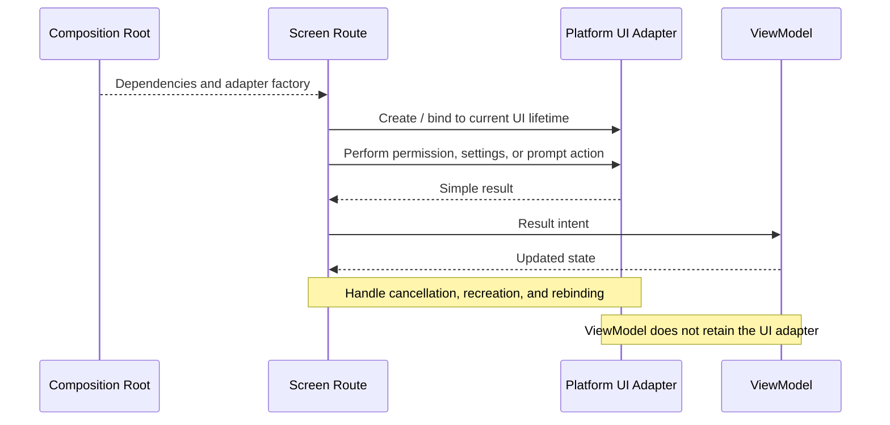

# Route and Screen contract — the boundary and the lifetimes

> `FeatureRoute`, `FeatureScreen`, `FeatureViewModel`, `FeatureUiState`, and `FeatureIntent` are
> this skill's default names. The project's own naming wins wherever it differs — the duties below
> hold under whatever the parts are called.

## Contents

1. The shape · 2. `FeatureRoute` — the integration entry point · 3. `FeatureScreen` — the
rendering API · 4. `FeatureViewModel` — the state owner · 5. Destination scope · 6. Lifetimes ·
7. Platform UI adapters · 8. DI at the boundary

## The shape

```
Navigation Graph → Screen Route → Screen → UI Components
```

The Route connects that rendering tree to the ViewModel. The ViewModel owns screen state and
calls use cases, which are designed under `clean-architecture`.

## `FeatureRoute` — the integration entry point

A stateful destination is entered through the Route, which has five duties:

1. **Receive** destination arguments, dependency or factory access, and navigation callbacks.
2. **Resolve the ViewModel** with the intended destination owner, preserving its scope across
   recomposition and across the configuration changes the platform supports.
3. **Collect its state with lifecycle awareness.** `collectAsStateWithLifecycle()` is the usual
   shape where the project's Lifecycle artifacts support it — verify the API against the pinned
   versions before using it. Collect with the destination's lifecycle, never with an accidental
   app-global owner.
4. **Pass state and event handlers** into `FeatureScreen`.
5. **Coordinate lifecycle-sensitive platform actions**, and consume navigation outcomes at this
   boundary.

Must keep out: rendering detail, business rules, storage calls.

## `FeatureScreen` — the rendering API

```kotlin
@Composable
fun FeatureScreen(
    state: FeatureUiState,
    onIntent: (FeatureIntent) -> Unit,
    onBack: () -> Unit,
    modifier: Modifier = Modifier,
)
```

An API illustration, not a compilable feature.

- Focused callbacks replace `onIntent` when the project uses them: the parameter list changes, the
  boundary does not.
- A private `FeatureScreenContent` is fine when the project separates scaffold and chrome from
  content. Follow the project's own scaffold and preview rules.
- No BaseScreen inheritance hierarchy, and no second component system beside one the project has.
- The Screen renders from a supplied fixture in previews and tests, and resolves no ViewModel and
  no DI.

## `FeatureViewModel` — the state owner

Owns screen state, intent handling, UI-state production, and operation outcomes. It exposes an
immutable state stream and keeps the mutable side, and every transition, private.

It calls **use cases only**. Their design, and the contracts behind them, belong to
`clean-architecture`; the ViewModel names neither a contract nor an implementation.

Must keep out: Activity, View, and Context references; permission launchers; navigation
controllers; repositories; data sources.

The operations it triggers are safe to call from the main thread. Blocking work and expensive
calculations move to a dispatcher inside the layer responsible for them, and those dispatchers are
replaceable in tests.

## Destination scope

Choose an explicit destination scope for each screen ViewModel — the scope is a decision recorded
in the ownership map, not whatever the resolution helper happens to hand back.

- A **graph-shared ViewModel** is appropriate only when several destinations deliberately share
  state, and that sharing is recorded in the ownership map.
- **Back-stack removal ends the scope.** Whatever the user should find again on re-entry has to
  outlive it somewhere else.
- A **static screen** receives navigation callbacks directly and has no ViewModel.
- A **plain state-holder class** is appropriate for UI coordination that needs no ViewModel scope.

## Lifetimes

> A dependency must be valid for the full lifetime of its consumer.

Never retain an Activity, a View, a permission launcher, or a UI-lifetime adapter inside a
ViewModel — not directly, and not indirectly through a gateway, a closure, a state holder, or a
factory.

Creating an Activity-bound adapter in a Route does not fix the mismatch if the ViewModel then
retains it. Keep UI-bound actions with the current UI, and forward their results as intents.

## Platform UI adapters



- Separate permission and presentation interactions from services that can do their work without
  holding UI objects.
- Resolve any required permission before using the service behind it.
- Handle denial, cancellation, and permission changes explicitly — each is a state the screen can
  be in, not an error path to be discovered later.
- On recreation, rebind the adapter and re-derive pending state from the ViewModel, never from the
  old adapter.

## DI at the boundary

- **Constructor injection by default.** Concrete dependencies are built in the composition root or
  its factories — never in a rendering composable, never in a ViewModel.
- **Reuse the project's DI framework** rather than adding a competing one for this pattern. Manual
  factories are valid.
- **Android-only projects that already use Hilt** may resolve the ViewModel at the Route or
  navigation boundary; `hiltViewModel()` is the usual shape there, verified against the pinned
  versions. Hilt is never a dependency of platform-neutral shared code.
- **KMP projects** use a mechanism matching their real shared and platform split, together with
  the project's compatible multiplatform ViewModel and Lifecycle APIs — confirm those artifacts
  are pinned rather than assuming Android-only APIs belong in shared code.
